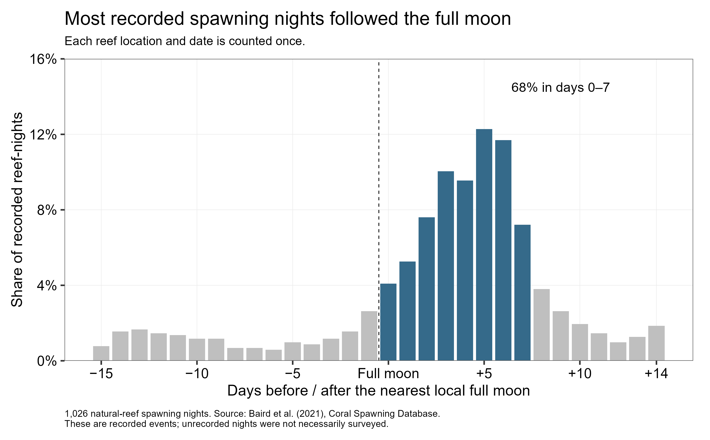

# The Ocean's Clock

We studied when corals spawn and how their recorded spawning seasons overlap with ocean heat stress. The work combines historical reef observations, NOAA's daily regional records and a separate aquarium diary. The analysis and figures are written in R.

About **68% of the recorded reef-nights fall in the week beginning at full moon**. An independent Acropora field study shows a similar concentration. The ocean surrounding those events is changing: severe heat stress reached **171 of the same 214 NOAA regions in 2024**, compared with five in 1986. We then connect the historical spawning calendars to those regional records and test whether extra environmental inputs improve predictions within one aquarium.



## The figures

Each figure answers one question. The plots use ordinary ggplot2 bars, boxplots, a line or points with uncertainty intervals. PNGs are exported at 300 dpi; SVG copies are available for resizing in Prezi.

| Figure | What to look for |
| --- | --- |
| [1. Spawning and full moon](outputs/figures/01_lunar_timing.png) | Most recorded nights are concentrated in a short part of the lunar cycle. |
| [2. Starting times after sunset](outputs/figures/02_night_timing.png) | Six coral genera have different recorded timing distributions. |
| [3. Regional heat stress over time](outputs/figures/03_heat_stress.png) | The same regional comparison reveals large changes and year-to-year variation. |
| [4. Heat exposure during spawning seasons](outputs/figures/04_spawning_exposure.png) | Five large increases and a zero-change example show that the overlap is uneven. |
| [5. Do extra environmental inputs help?](outputs/figures/05_model_comparison.png) | Adding preceding-week conditions gives no clear predictive gain in the held-out-year test. |
| [6. A second field study](outputs/figures/06_field_comparison.png) | About 70% of Acropora records fall in the same lunar window in both studies. |

[Findings](outputs/RESULTS.md) explain the results in words. The [plot guide](docs/PLOT_GUIDE.md) explains the axes, counting units and limits of each comparison. For a short presentation, figures 1, 3, 4 and 5 give a useful route through the project; the other two add biological detail and an independent comparison.

## How the project is organised

`run.R` is the entry point. It prepares the data, runs the analyses, then draws the six figures. Data preparation and plotting are separate, so each plot script can be read on its own.

```text
The-Oceans-Clock.Rproj     Open this file in RStudio
run.R                     Run the complete project
setup.R                   Install missing R packages once
R/
  prepare_coral.R         Read and join observations, sites and species
  prepare_ocean.R         Read NOAA histories; match reef coordinates to regions
  analyse_heat_exposure.R Compare heat stress around historical spawning seasons
  fit_aquarium_models.R   Fit and test models with whole years held out
  compare_field_studies.R Summarise the independent Maldives observations
  export_spatial_data.R   Write the region and reef Shapefiles
  plots/                  Six short ggplot scripts, plus a shared theme
data/
  raw/                    Original downloaded files and source notes
  derived/                Joined data and full analytical results
  spatial/                Shapefiles for inspection in R or GIS software
outputs/
  figures/                The six presentation PNGs
  vector/                 SVG versions of the same figures
  tables/                 Plot values and model diagnostics
  models/                 Fitted models and a native R workspace snapshot
docs/                     Methods, sources, course requirements and checks
tools/                    Download utility and independent numerical checks
```

The field-data connection is: **observation ID → reef coordinates → NOAA region polygon → region and date**. This produces environmental matches for 751 recorded reef-nights. The aquarium analysis is a separate branch: its diary and environmental measurements join by date. We do not combine tank observations and wild-reef events into one model.

The remaining short R scripts check the lunar reference, write the findings and validate the exports. Their execution order is visible in `run.R`.

## Run it in RStudio

Open `The-Oceans-Clock.Rproj`, then run:

```r
source("setup.R")
source("run.R", encoding = "UTF-8")
```

Setup needs an internet connection for missing packages. The analysis then uses the included source caches. To redraw one figure from the prepared data, run its script, for example:

```r
source("R/plots/01_lunar_timing.R", encoding = "UTF-8")
```

The [R workspace snapshot](outputs/models/analysis_workspace.RData) contains selected analytical objects and fitted models; the [session history](outputs/session.Rhistory) records commands actually run. They can help when inspecting the work, but `run.R` starts from explicit input files. The large parsed NOAA RDS file is rebuilt locally from the included compressed sources.

## Data and geography

| Source | What it supplies |
| --- | --- |
| [Coral Spawning Database](https://doi.org/10.25405/data.ncl.13082333.v1) | 6,178 source observations, with separate location and taxonomy tables; 1,026 recorded natural-reef location-dates. |
| [NOAA Coral Reef Watch](https://coralreefwatch.noaa.gov/product/vs/data.php) | 3,203,007 available daily regional records in 1985–2025. The main comparison uses the complete common period, 1986–2024. |
| [Churaumi Aquarium study](https://doi.org/10.5281/zenodo.10974150) | Fifteen seasonal diaries, including observed non-spawning days, with environmental measurements. |
| [Maldives field study](https://doi.org/10.7717/peerj.19447) | 81 spawning atoll-days, representing 3,026 colony observations, analysed separately. |
| [US Naval Observatory](https://aa.usno.navy.mil/data/api.html) | A limited independent check of seven covered historical reef-nights. |

NOAA publishes its region boundaries as GeoJSON. `sf::st_join()` uses those polygons to identify each reef's region. The [spatial folder](data/spatial/) contains Shapefile copies of all 214 region polygons and 102 reef coordinates, with their identifiers and WGS84 reference system. Read a layer with `sf::st_read("data/spatial/reef_sites.shp")`. The [spatial notes](data/spatial/README.md) explain the fields and source.

Source definitions, licences and the main limitations are in [the research notes](docs/RESEARCH.md). The field data contain recorded occurrences with incomplete observation effort; the aquarium diary contains explicit zero days within its monitoring seasons. That difference determines which questions each source can answer.

## Methods and submission

The heat-exposure index weights monthly heat-stress conditions by the recorded spawning calendar. It holds that calendar fixed, so it describes environmental overlap rather than a shift in spawning or reproductive failure. The prediction comparison excludes one whole year before testing it. Equations and numerical checks are in the [methods](docs/METHODS.md), [aquarium analysis](docs/AQUARIUM_METHODS.md) and [validation record](docs/VALIDATION.md).

Mihael and Pirasanna are the project team. Main-author export assignments are in `authors.csv`; the students still need to review their actual contributions and understand the calculations. Run `source("export_submission.R")` to create named PNGs and the complete R-project ZIP under `submission/`. The [course requirements](docs/COURSE_REQUIREMENTS.md) retain the presentation, attendance, group-format and Moodle details.
