<p align="center">
  
</p>

<p align="center">
  <a href="https://github.com/atanasovmi/the-oceans-clock/actions/workflows/reproduce.yml"></a>
  <a href="https://github.com/atanasovmi/the-oceans-clock/releases/latest"></a>
  
  <a href="docs/LICENSES.md"></a>
</p>

On a few nights each year, whole reefs of corals release their eggs and sperm into the sea within the same hours. We wanted to know how much of that timing shows up in the records. So we joined **6,178 historical coral observations** with **3.2 million daily NOAA ocean records**, NASA Moon positions, a fifteen-year aquarium diary and a tank experiment, then measured the year, the Moon and the Sun on one scale.

The full-moon story that usually leads this topic turned out to be the loosest of the three clocks. Warming water opens the season, the Moon narrows the night, and sunset sets the hour. Around all three, the ocean is changing: severe heat stress reached **171 of 214 NOAA reef regions in 2024**, against five in 1986.

We chose this topic because we wanted to work on something connected to nature, with no business value to chase. The blockweek at FHNW gave us a lab setting for following a niche question for its own sake.

<p align="center">
  <a href="https://github.com/atanasovmi/the-oceans-clock/releases/latest/download/Korallen-das-Weltspektakel.pptx"></a>
  <a href="outputs/RESULTS.md"></a>
  <a href="docs/PLOT_GUIDE.md"></a>
  <a href="docs/METHODS.md"></a>
  <a href="docs/VALIDATION.md"></a>
</p>

<p align="center">
  <a href="#three-clocks-on-one-scale"><kbd>Three clocks</kbd></a>
  <a href="#the-plots"><kbd>The plots</kbd></a>
  <a href="#how-the-sources-connect"><kbd>The sources</kbd></a>
  <a href="#the-decisions-that-shaped-it"><kbd>Key decisions</kbd></a>
  <a href="#from-history-to-forecast"><kbd>Outlook</kbd></a>
  <a href="#run-it-yourself"><kbd>Run it</kbd></a>
  <a href="#what-this-work-is-and-is-not"><kbd>Scope</kbd></a>
  <a href="#team-and-thanks"><kbd>Team</kbd></a>
</p>


## Three clocks on one scale

<p align="center"></p>

A year, a lunar month and a day have different units, so we needed one measure that works on all of them. Each record becomes an arrow on a circle, and **R** is the length of the average arrow: 0 means the records are spread evenly around the cycle, 1 means they all fall at one moment. On that scale the Sun holds spawning most tightly and the Moon least.

<details>
<summary><b>Why ordinary statistics fail here, and how R works</b></summary>
<br>

Our timing data is circular. The year, the lunar month and the day have no real start or end, so the last point of each sits next to the first. Day −14 and day +14 of the lunar month are neighbours, yet their ordinary mean lands on full moon, the opposite side of the cycle. We therefore use circular statistics, also called directional statistics.

Tightness is the mean resultant length, written R̄ (R on the plots). It describes concentration. It is neither a confidence interval nor Pearson's r. Two opposite clusters can cancel to a low R, so the plots show the records beside the number. For further reading, see Fisher, *Statistical Analysis of Circular Data* (1993), and Mardia & Jupp, *Directional Statistics* (2000).


The animation loops through three real places and one made-up example. Each pink dot is a record and each thin line its arrow. The blue and gold lines are C̄ and S̄, the mean east and north parts, and the white arrow built from them has length R̄.

The `circular` package has the same measure as [`rho.circular()`](https://search.r-project.org/CRAN/refmans/circular/html/rho.circular.html). We write the calculation out in `circular_summary()` in `R/analyse_clocks.R` so each step stays visible. For Raffles Lighthouse, Akajima and Eilat, both give the same value to six decimals.

</details>


## The plots

Every plot is drawn in R with ggplot2, answers one question and carries its values in [`outputs/tables`](outputs/tables). Click a plot for the full 300 dpi version. Vector copies are in [`outputs/vector`](outputs/vector).

### Defended live

These five carried our final presentation.

#### Which cycle holds the records most tightly?

<a href="outputs/figures/01_three_clocks.png">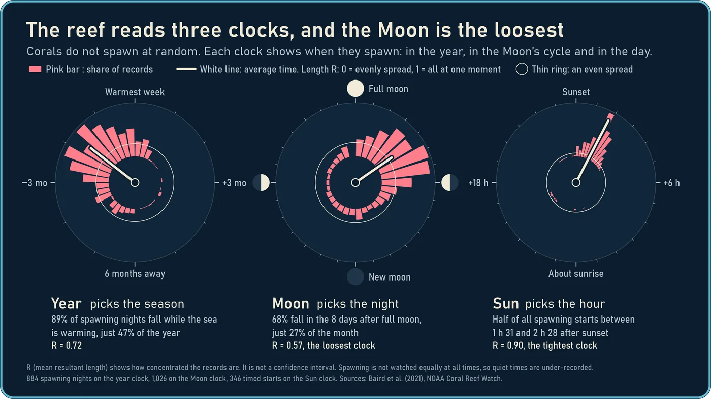</a>

Three dials, one scale. The Sun scores 0.90, the year 0.72 and the Moon 0.57.

#### What does the season follow?

<a href="outputs/figures/02_season.png">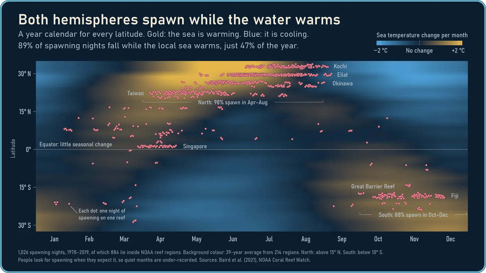</a>

Calendar months cannot be compared across the equator, so each NOAA region gets its own temperature year. Of 884 reef-nights, 89% fall while the local sea is warming, a stretch covering 47% of the year. Teams look for spawning when they expect it, so this share is likely too high.

#### Do all reefs follow the Moon equally?

<a href="outputs/figures/03_moon.png">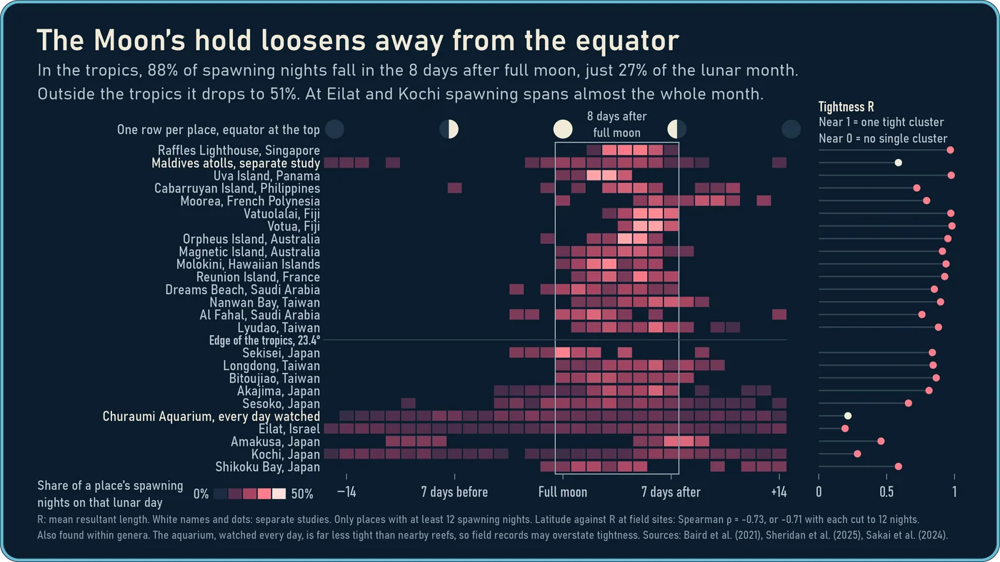</a>

Inside the tropics, 88% of reef-nights fall in the eight days from full moon. Beyond them it is 51%. Across 23 sites, lunar tightness falls with distance from the equator (Spearman ρ = −0.73, p < 0.001), and the trend holds with Eilat and Kochi removed.

#### How has heat stress changed?

<a href="outputs/figures/07_heat_years.png">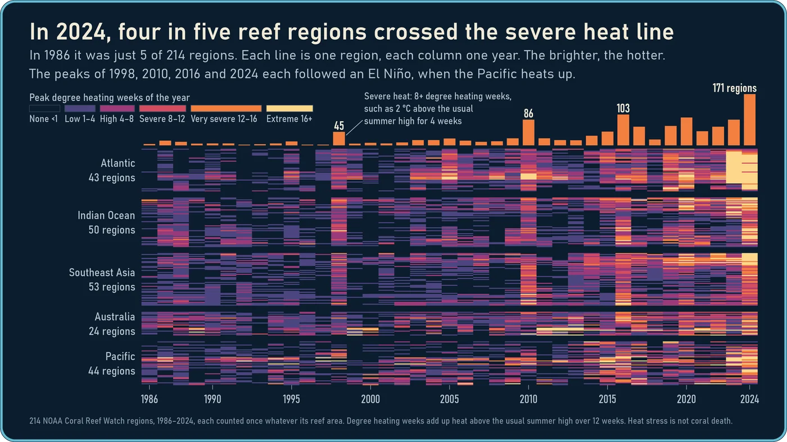</a>

Five of 214 regions reached 8 degree heating weeks in 1986, and 171 did in 2024. The peaks of 1998, 2010, 2016 and 2024 each followed an El Niño. Degree heating weeks measure accumulated heat, not coral death.

#### Do all genera keep the same time?

<a href="outputs/figures/09_genera.png">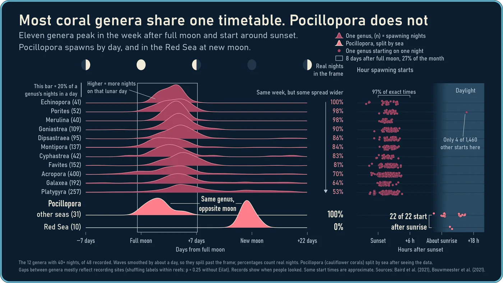</a>

Across 20 genera, the typical night falls 3 to 7 days after full moon. *Pocillopora* is the clear outlier: all 22 of its timed starts come after sunrise, and in the Red Sea all 10 of its nights fall within 2 days of new moon. That split by sea was chosen after seeing the data.

### The supporting evidence

These five test the story from other angles.

<table>
<tr>
<td width="50%" valign="top">
<a href="outputs/figures/04_sky.png">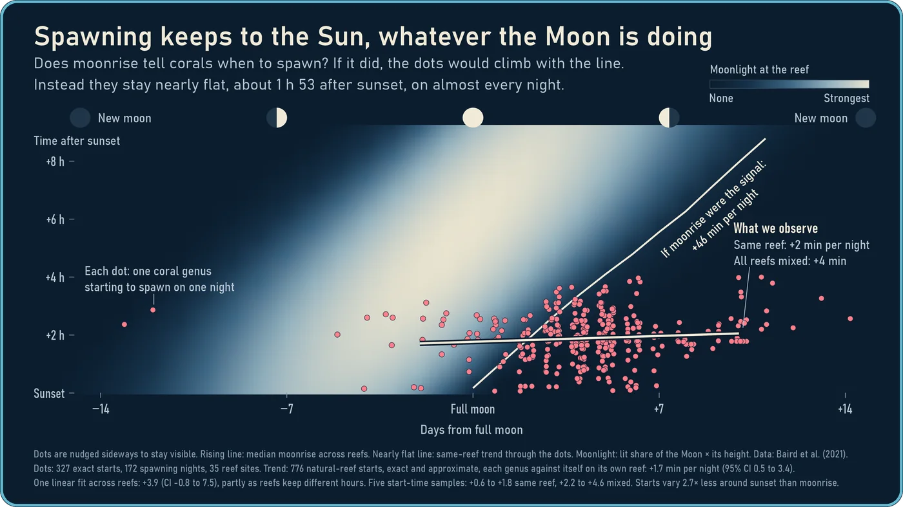</a>
<br><b>Does the Sun or the Moon set the hour?</b>
<br>Moonrise moves about 46 minutes later each night. On the same reef, a genus starts only 1.7 minutes later (95% interval 0.5 to 3.4).
</td>
<td width="50%" valign="top">
<a href="outputs/figures/04.01_sky.png">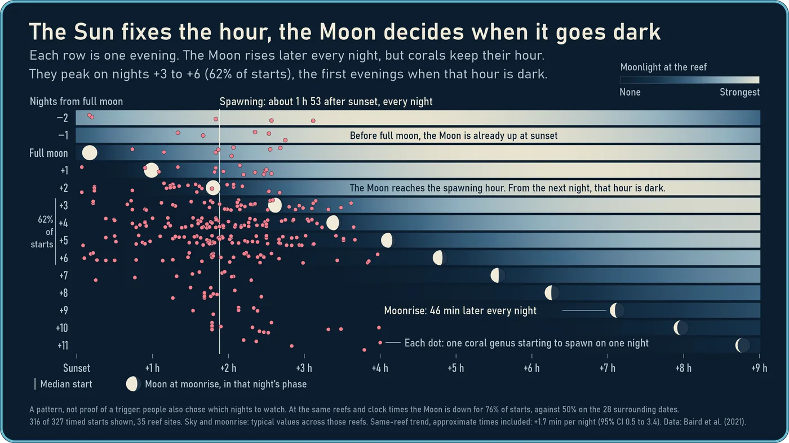</a>
<br><b>The same question, one row per evening</b>
<br>The moons step to the right while the spawning dots stay near two hours after sunset.
</td>
</tr>
<tr>
<td width="50%" valign="top">
<a href="outputs/figures/05_diary.png">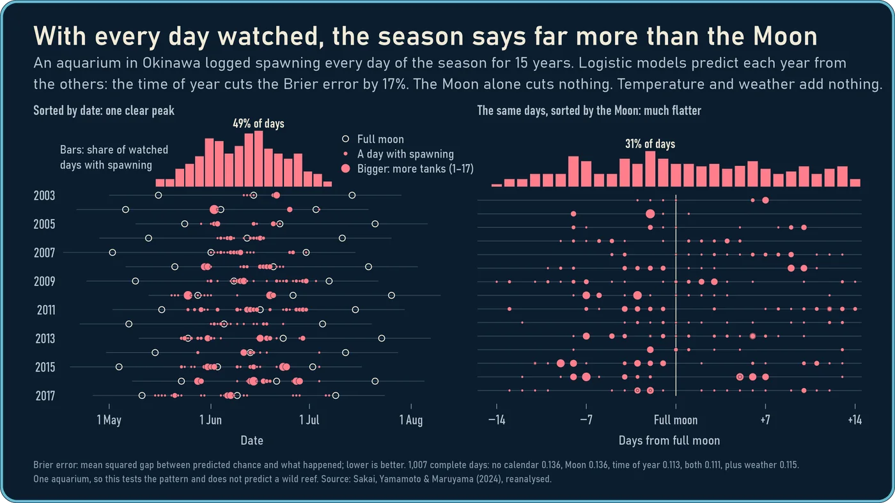</a>
<br><b>Does the pattern survive when every day is watched?</b>
<br>In the aquarium, 32% of spawning days fall in the eight days from full moon, against 27% of days watched. Season cuts forecast error by 17%. Adding the Moon gains 0.0014 (95% interval −0.0032 to 0.0059), which includes zero.
</td>
<td width="50%" valign="top">
<a href="outputs/figures/06_minutes.png">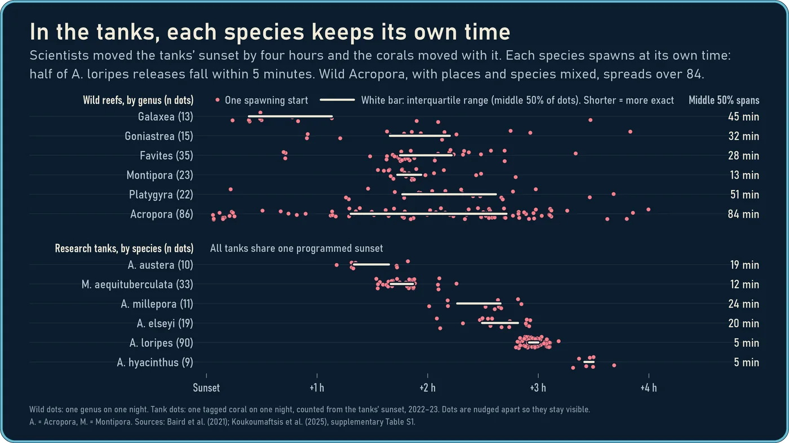</a>
<br><b>How precise is the Sun clock?</b>
<br>Against one programmed sunset, half of the <i>Acropora loripes</i> releases fall within 5 minutes. In the wild, with places and species mixed, <i>Acropora</i> spreads over 84.
</td>
</tr>
<tr>
<td width="50%" valign="top">
<a href="outputs/figures/08_heat_season.png">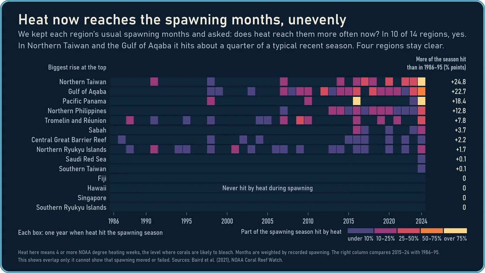</a>
<br><b>Does the heat reach the spawning months?</b>
<br>Holding each region's spawning months fixed, ten of fourteen regions now see more heat stress in them and four stay clear. Northern Taiwan rises from 1.5% to 26.3%, the Gulf of Aqaba from 0.0% to 22.7%.
</td>
<td width="50%" valign="top">
<br><b>Go deeper</b>
<br><br>The <a href="outputs/RESULTS.md">findings</a> tell the whole story in words.
<br><br>The <a href="docs/PLOT_GUIDE.md">plot guide</a> explains how to read each plot.
<br><br>The <a href="docs/SCIENCE_REVIEW.md">interpretation checks</a> list what could mislead.
</td>
</tr>
</table>


## How the sources connect

<p align="center"></p>

No single source can answer the question, because each one has a blind spot. The project works by letting them check each other.

| Source | What it sees | What it cannot see |
| --- | --- | --- |
| [Coral Spawning Database](https://doi.org/10.25405/data.ncl.13082333.v1) | Decades of spawning across the world's reefs | The nights nobody went out |
| [NOAA Coral Reef Watch](https://coralreefwatch.noaa.gov/product/vs/data.php) | Daily heat in 214 regions since 1985 | The water at an individual coral |
| [NASA/JPL Horizons](https://ssd.jpl.nasa.gov/horizons/) | Exactly where the Moon was | Whether clouds hid it |
| [Churaumi Aquarium](https://doi.org/10.5281/zenodo.10974150) | Every day watched, with the zeros written down | A wild reef |
| [Sea Simulator](https://doi.org/10.1098/rspb.2025.1558) | Controlled seasons and light, timed to the minute | The open ocean |
| [Maldives field study](https://doi.org/10.7717/peerj.19447) | An independent, recent field record | Anywhere beyond two atolls |

The main connection runs **observation ID → reef coordinates → NOAA region polygon → region and date**. Of the 1,026 recorded reef-nights, 751 match an exact NOAA day, 142 fall outside NOAA's regions and 133 predate its records. A limited [US Naval Observatory](https://aa.usno.navy.mil/data/api.html) check covers seven of those nights.

About 23.1 million source values sit behind the project, and 98.9% of them are NOAA records. The 6,178 coral observations are far fewer, and they set the limit on what the biology can show.

| Source | Values | Share |
| --- | ---: | --- |
| NOAA Coral Reef Watch | 22,877,449 | `████████` 98.90% |
| Coral Spawning Database | 170,314 | `▏` 0.74% |
| Churaumi Aquarium | 68,369 | `▏` 0.30% |
| NASA/JPL Horizons | 12,897 | `▏` 0.06% |
| Sea Simulator | 1,032 | `▏` <0.01% |
| Maldives study | 972 | `▏` <0.01% |
| **Total** | **23,131,033** | |

<details>
<summary><b>Where each source is stored</b></summary>
<br>

- **NOAA:** [`data/raw/crw/`](data/raw/crw/) holds 214 regional `.txt.gz` files, fetched from the [station index](https://coralreefwatch.noaa.gov/product/vs/data.php) by [`tools/fetch_crw.py`](tools/fetch_crw.py). The data runs to 1 Nov 2026.
- **Coral Spawning Database:** [`data/raw/coral/CSD_Tables.xlsx`](data/raw/coral/CSD_Tables.xlsx) is the Excel export of an Access database, version 1 from Dec 2020, from [Newcastle University's repository](https://outputs.ncl.ac.uk/articles/dataset/Coral_Spawning_Database/13082333).
- **Aquarium:** [`data/raw/aquarium/`](data/raw/aquarium/) holds two CSVs and the source zip from [Zenodo](https://doi.org/10.5281/zenodo.10974150), published in Apr 2024.
- **Horizons:** [`data/raw/horizons/reef_moon_positions.zip`](data/raw/horizons/reef_moon_positions.zip) holds 35 JSON files, retrieved on 3 Nov 2026 from the [Horizons file API](https://ssd-api.jpl.nasa.gov/doc/horizons_file.html) by [`tools/fetch_moon_positions.py`](tools/fetch_moon_positions.py).
- **Sea Simulator:** [`data/raw/seasim/`](data/raw/seasim/) holds the [supplementary PDF](https://doi.org/10.6084/m9.figshare.29940717.v1), published in 2025. R reads Table S1 from it.
- **Maldives:** [`data/raw/maldives/`](data/raw/maldives/) holds [one CSV](https://doi.org/10.7717/peerj.19447/supp-4), published in 2025.

</details>

<details>
<summary><b>How the values are counted</b></summary>
<br>

Values are rows × columns in the source files.

- **NOAA:** 3,268,207 region-days × 7 measures, from 214 regions with about 15,272 days each. The analysis keeps the 3,203,007 days through 2025, and the partial 2026 stays in the raw files.
- **Coral Spawning Database:** six distinct tables. The workbook has eight sheets, but three hold the same 6,178 observations, so they are counted once.
- **Horizons:** one value per Moon position.
- **US Naval Observatory:** not counted, because it is a single saved response used as a check.

</details>

<details>
<summary><b>Geography</b></summary>
<br>

NOAA publishes its region boundaries as GeoJSON, and `sf::st_join()` uses those polygons to identify each reef's region. The [spatial folder](data/spatial/) contains Shapefile copies of all 214 region polygons and 102 reef coordinates, with their identifiers and WGS84 reference system. Read a layer with `sf::st_read("data/spatial/reef_sites.shp")`. The [spatial notes](data/spatial/README.md) explain the fields.

</details>


## The decisions that shaped it

Eight design decisions define what this project can and cannot say.

<table>
<tr>
<td width="84" align="center"></td>
<td><b>Count reef-nights, not rows.</b> A detailed species list should not outvote a plain one. Counting rows puts 80.3% in the eight days from full moon, while counting each reef-night once gives 67.7%.</td>
</tr>
<tr>
<td align="center"></td>
<td><b>Treat time as a circle.</b> Circular statistics keep day −14 and day +14 together as neighbours. They also give one measure, R, that compares cycles counted in days, lunar days and hours.</td>
</tr>
<tr>
<td align="center"></td>
<td><b>Give every region its own year.</b> April means different things on either side of the equator. Each NOAA region gets a typical temperature year, so both hemispheres share one axis.</td>
</tr>
<tr>
<td align="center"></td>
<td><b>Join only where a real key exists.</b> Reef coordinates fall inside a published NOAA polygon, then match on date. The tank and Maldives studies share no key with the database, so they stay beside it and never enter one model.</td>
</tr>
<tr>
<td align="center"></td>
<td><b>Forecast only where zeros exist.</b> Field records list events and leave out the empty nights. Only the aquarium diary writes those days down, so only it can support a daily prediction, scored by Brier error on whole years held out.</td>
</tr>
<tr>
<td align="center"></td>
<td><b>Try to break each finding before plotting it.</b> We shuffled labels, dropped sites and resampled whole reefs. A difference between genera on shared reefs looked strong (p &lt; 0.001) but fell to p = 0.25 without Eilat, so we withdrew it. A drift of 3.9 minutes a night became 1.7 once each genus was compared with itself on its own reef.</td>
</tr>
<tr>
<td align="center"></td>
<td><b>Hold the calendar still.</b> The heat index fixes each region's recorded spawning months, so any change comes from the heat alone. It measures overlap and says nothing about whether corals moved or failed.</td>
</tr>
<tr>
<td align="center"></td>
<td><b>Freeze every source.</b> Downloads and API responses are saved unchanged, with hashes where the source allows, so a run needs no live service. <a href=".github/workflows/reproduce.yml">GitHub Actions</a> rebuilds every table and plot on a clean machine. Separate <a href="docs/VALIDATION.md">Python checks</a> reproduce 546 region-years, 4,028 model inputs and 56 held-out fits, and our Moon formula agrees with all 12,897 NASA positions to within 0.3°.</td>
</tr>
</table>

What sets the work apart is this cross-examination. The field records alone would have told the classic full-moon story. Reading them against a diary with its empty days written down, and against tanks where the sky could be moved, turned it into a more careful one.


## From history to forecast

Everything above describes the past. Talking about the future takes two steps: data that closes today's blind spots, and models built for the shape of that data.

### Data we would add

| Source | Blind spot it closes | Watch out for |
| --- | --- | --- |
| **Survey effort logs** from field teams | The biggest gap. Knowing which nights people watched turns occurrences into rates. | Rarely published, so this means asking teams directly. |
| [**NASA POWER**](https://power.larc.nasa.gov/) | Daily cloud, wind, rain and sunlight at any coordinates since 1981. Cloud shows whether the Moon was actually visible. | Grid cells of about ½° × ⅝° describe the wider area. |
| [**Coral Trait Database**](https://www.coraltraits.org) | 172 traits for 5,112 species under CC0, such as egg size and growth form. Do tight spawners share a biology? | Names need matching, and its `Spawning date` trait may repeat our records. |
| **In-water temperature loggers**, such as [AIMS](https://www.aims.gov.au/) reef sites | The water at the coral, where NOAA gives a regional statistic. | Only some reefs, with gaps. |
| **VIIRS night lights** | Artificial light can disturb gamete development and timing ([Ayalon et al. 2021](https://doi.org/10.1016/j.cub.2020.10.039)), so coastal glow belongs next to the Moon. | Measures light seen from space, not under water. |
| **CMIP6 sea temperature scenarios** | Takes heat exposure beyond today's records. | Needs bias correction against NOAA's baseline. |

### Models we would try

Each question has a different data shape, and the shape picks the model.

| Question | Model | Why this one |
| --- | --- | --- |
| How likely is spawning tonight on a monitored reef? | **Hierarchical binomial GAM** with cyclic splines for lunar day and day of year, and random effects for reef and year (`mgcv`, `brms`) | Smooth cycles without forcing a shape. Partial pooling lets thin reefs borrow from well-watched ones. |
| When does this season's first night come? | **Discrete-time hazard model**, complementary log-log link, with warming rate as a time-varying input | First spawning is a time-to-event outcome. Rapid warming is a published predictor of the spawning month ([Keith et al. 2016](https://doi.org/10.1098/rspb.2016.0011)). |
| What can field records say without zeros? | **Inhomogeneous Poisson point process** with survey effort as an offset ([Warton & Shepherd 2010](https://doi.org/10.1214/10-AOAS331)) | Models the rate of records directly and never treats an unwatched night as an absence. |
| How does lunar tightness change with latitude? | **von Mises regression** with concentration modelled on latitude, and a von Mises mixture for two-peak taxa | Keeps the outcome on the circle, and turns plot 3 into a tested slope. *Pocillopora* needs two peaks. |
| How often will severe heat return? | **Non-stationary extreme value model** (GEV or peaks over threshold, `extRemes`) with year and Niño 3.4 as covariates | Severe heat is a tail question, and mean regression says little about tails. |
| What does 2050 look like? | **Bayesian space-time model** (`R-INLA`) run under CMIP6 scenarios SSP1-2.6, SSP2-4.5 and SSP5-8.5 | Neighbouring regions share heat. The output is a projection conditional on a scenario, and it should be labelled as one. |
| Is any of this better than a flexible black box? | **Gradient boosting** (`xgboost`) as a benchmark | With 208 spawning days, simple models may win. It stays in only if it beats them out of sample. |

Every candidate would face the same rules. Validation runs forward in time, training on the past and predicting the next year, because our own leave-one-year-out test still learns from later years. Reefs are held out whole as well. Scores are proper ones (Brier, log score, CRPS), checked with calibration plots against a seasonal baseline. A model that cannot beat the calendar does not get published as a forecast.

The questions worth chasing are whether synchrony itself is eroding, as reported on Red Sea reefs ([Shlesinger & Loya 2019](https://doi.org/10.1126/science.aax0110)), and how much of the heat overlap in plot 8 corals can avoid by shifting their timing.


## Run it yourself

Open `The-Oceans-Clock.Rproj` in RStudio, then run:

```r
source("setup.R")                    # once: installs missing packages into .Rlibrary
source("run.R", encoding = "UTF-8")  # prepares the data, runs the analyses, draws every plot
```

Setup needs an internet connection for packages. The analysis itself uses the saved sources. To redraw one plot from the prepared data, run its script, for example `source("R/plots/04_sky.R", encoding = "UTF-8")`.

The plots use Bahnschrift, which ships with Windows. Other systems fall back to their default sans-serif, so text widths shift slightly and the committed PNGs stay the reference.

<details>
<summary><b>How the project is organised</b></summary>
<br>

```text
The-Oceans-Clock.Rproj     Open this file in RStudio
run.R                      Run the complete project
setup.R                    Install missing R packages once
DESCRIPTION                Authors and R dependencies (a research compendium, not a package)
R/
  prepare_*.R              Read and join the sources; build each region's temperature year and the sky
  analyse_*.R              Measure the clocks, the genera and the heat exposure
  fit_aquarium_models.R    Fit and test models with whole years held out
  compare_field_studies.R  Summarise the independent Maldives observations
  check_*.R                Check the lunar reference, data totals and exports
  plots/                   One ggplot script per plot, plus the shared style
data/
  raw/                     Original downloaded files and source notes
  derived/                 Joined data and full analytical results
  spatial/                 Shapefiles for R or GIS software
outputs/
  figures/                 Presentation PNGs at 300 dpi
  vector/                  SVG versions of the same plots
  tables/                  Plot values and model diagnostics
  models/                  Fitted models and a native R workspace snapshot
docs/                      Methods, sources, validation and a guide to the plots
tools/                     Download utilities, independent checks and the README artwork
```

Data preparation and plotting are separate, so each plot script can be read on its own. The [walkthrough](docs/LEARNING_GUIDE.md) follows one question through the files. The [R workspace snapshot](outputs/models/analysis_workspace.RData) and [session history](outputs/session.Rhistory) can help when inspecting the work, but `run.R` starts from explicit input files.

</details>


## What this work is, and is not

This is exploratory student work from a one-week course. It has not been peer reviewed, and we would rather state its limits than have a reader find them.

<table>
<tr>
<th width="50%">What we deliver</th>
<th width="50%">What we do not claim</th>
</tr>
<tr>
<td valign="top">

- A reproducible analysis that rebuilds every table and plot from saved sources
- Descriptive patterns among **recorded** spawning events, with each denominator stated
- A retrospective test of forecast skill in **one aquarium**
- A heat-overlap index for a fixed historical calendar in **fourteen regions**
- Independent numerical checks of the main calculations
- A comparison of several published datasets, each credited to its authors

</td>
<td valign="top">

- **Causes.** These are associations. We do not show what cue a coral uses.
- **Spawning probabilities.** Field shares describe recorded events under unknown survey effort, and they are not the chance of spawning on a given night.
- **A forecasting tool.** The model describes one aquarium and was tested retrospectively. It does not forecast a wild reef.
- **Reef-level temperature.** NOAA values are regional statistics, not measurements at the coral.
- **Effects of heat on reproduction.** Degree heating weeks measure accumulated heat. We did not observe shifted timing, failed spawning or coral death.
- **Global coverage.** Records cluster where researchers worked, and NOAA regions count equally whatever their reef area.
- **New biology.** Others have studied these cycles first. Our contribution is the integration and the checks.

</td>
</tr>
</table>

Some comparisons were chosen after seeing the data, such as the split of *Pocillopora* by sea, so their p-values are descriptive. The [research notes](docs/RESEARCH.md) and [interpretation checks](docs/SCIENCE_REVIEW.md) give the full reasoning.

### How we used AI

The work ran on a harness engine we built ourselves, in Docker sandboxes (`sbx`). It used Claude Code with Opus 5.5, Codex with GPT 6.1 Sol, and open-source models such as Qwen and DeepSeek from Hugging Face.

The harness was a looping workflow with a good number of agents, working to clear goals and a clear structure. It ran for **18 hours, 21 minutes and 43 seconds** straight, through many iterations, with the two of us steering throughout.


## Team and thanks

<p align="center">
  <a href="https://www.fhnw.ch/en"></a>
</p>

**Mihael Atanasov** (lead) and **Pirasanna Siva** built this project for the Applied Data Science blockweek at the [University of Applied Sciences and Arts Northwestern Switzerland](https://www.fhnw.ch/en), presented on 6 November 2026.

We thank our professors **Martin Sterchi**, **Fabian Heimsch** and **Nathan Brack** for their help and guidance. For the course assessors, [this page](docs/COURSE_CRITERIA.md) (in German) maps each published criterion to where it can be checked.

We also thank the researchers and agencies whose open data made this possible: Baird and colleagues for the Coral Spawning Database, Sakai, Yamamoto and Maruyama for the Churaumi Aquarium records, Sheridan and colleagues for the Maldives observations, the authors of the Sea Simulator study, NOAA Coral Reef Watch, NASA/JPL and the US Naval Observatory.

To cite this work, use **Cite this repository** in the sidebar, which reads [`CITATION.cff`](CITATION.cff). Code is under the [MIT licence](LICENSE), plots and text under CC BY 4.0, and source data stays under its own terms, as set out in [`docs/LICENSES.md`](docs/LICENSES.md).

<p align="center">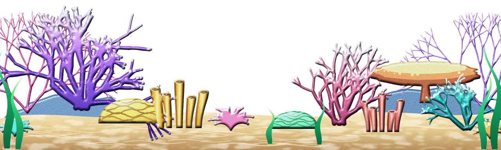</p>
