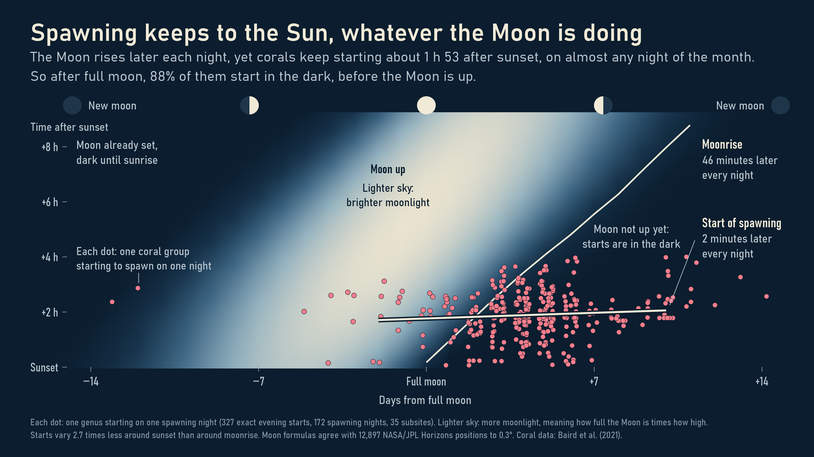

# The Ocean's Clock

What tells a coral reef that tonight is the night? We combined historical reef observations, NOAA's daily regional records, NASA Moon positions, a fifteen-year aquarium diary and a tank experiment to see how spawning fits the rhythms of the ocean. The analysis and all graphics are written in R.

The records point to three clocks. Warming water opens the season: 89% of recorded reef-nights fall in the warming part of the local year. The Moon narrows the night, far more inside the tropics (88% in the eight days from full moon) than beyond them (51%). Sunset sets the hour: starts stay near two hours after sunset while moonrise moves about 46 minutes a night. In the one record with every day watched, season carries almost all of the forecast and the Moon adds little. Around these clocks the ocean is changing: severe heat stress reached **171 of 214 NOAA reef regions in 2024**, compared with five in 1986.



## The plates

PNGs are exported at 300 dpi; SVG copies are available for resizing in Prezi.

| Plate | Question | What to look for |
| --- | --- | --- |
| [1. Three clocks](outputs/figures/01_three_clocks.png) | Which cycles hold the records, and how tightly? | The Sun's hand is longest, the Moon's shortest. |
| [2. The year](outputs/figures/02_season.png) | What does the season follow? | Both hemispheres sit on the warming part of the year. |
| [3. The Moon](outputs/figures/03_moon.png) | Do all reefs follow the Moon equally? | Tight near the equator, loose beyond the tropics. |
| [4. The sky](outputs/figures/04_sky.png) | Does the Sun or the Moon set the hour? | Moonrise climbs while the start of spawning stays flat. |
| [5. The diary](outputs/figures/05_diary.png) | Does the pattern survive when every day is watched? | Spawning lines up with the calendar far more than with the Moon. |
| [6. Minutes](outputs/figures/06_minutes.png) | How precise is the Sun clock? | Wide clouds in the wild, tight clusters in the tanks. |
| [7. The heat](outputs/figures/07_heat_years.png) | How has heat stress changed? | Each stripe of heat, ending with 171 of 214 regions in 2024. |
| [8. Heat in the season](outputs/figures/08_heat_season.png) | Does the heat reach the spawning months? | Ten of fourteen regions rose, four stayed clear. |

The [findings](outputs/RESULTS.md) explain the results in words. The [plot guide](docs/PLOT_GUIDE.md) says how to read each plate, what to say about it and which questions to expect.

## How the project is organised

`run.R` is the entry point. It prepares the data, runs the analyses, then draws the eight plates. Data preparation and plotting are separate, so each plot script can be read on its own.

```text
The-Oceans-Clock.Rproj     Open this file in RStudio
run.R                     Run the complete project
setup.R                   Install missing R packages once
R/
  prepare_coral.R         Read and join observations, sites and species
  prepare_ocean.R         Read NOAA histories; match reef coordinates to regions
  prepare_seasons.R       Build each region's typical temperature year
  prepare_sky.R           Calculate Moon and Sun positions; check them against NASA
  analyse_clocks.R        Measure how tightly each cycle holds the records
  analyse_heat_exposure.R Compare heat stress around historical spawning seasons
  fit_aquarium_models.R   Fit and test models with whole years held out
  compare_field_studies.R Summarise the independent Maldives observations
  export_spatial_data.R   Write the region and reef Shapefiles
  plots/                  Eight ggplot scripts, plus the shared style
data/
  raw/                    Original downloaded files and source notes
  derived/                Joined data and full analytical results
  spatial/                Shapefiles for inspection in R or GIS software
outputs/
  figures/                The eight presentation PNGs
  vector/                 SVG versions of the same plates
  tables/                 Plot values and model diagnostics
  models/                 Fitted models and a native R workspace snapshot
docs/                     Methods, sources, course requirements and checks
tools/                    Download utilities and independent numerical checks
```

The field-data connection is: **observation ID → reef coordinates → NOAA region polygon → region and date**. This produces environmental matches for 751 recorded reef-nights. The aquarium analysis is a separate branch: its diary and environmental measurements join by date. We do not combine tank observations and wild-reef events into one model.

The remaining short R scripts check the lunar reference, write the findings and validate the exports. Their execution order is visible in `run.R`.

## Run it in RStudio

Open `The-Oceans-Clock.Rproj`, then run:

```r
source("setup.R")
source("run.R", encoding = "UTF-8")
```

Setup needs an internet connection for missing packages. The analysis then uses the included source caches. To redraw one plate from the prepared data, run its script, for example:

```r
source("R/plots/04_sky.R", encoding = "UTF-8")
```

The plates use Bahnschrift, the DIN typeface that ships with Windows. On another system they fall back to the default sans-serif, so text widths shift slightly. The committed PNGs are the reference.

The [R workspace snapshot](outputs/models/analysis_workspace.RData) contains selected analytical objects and fitted models; the [session history](outputs/session.Rhistory) records commands actually run. They can help when inspecting the work, but `run.R` starts from explicit input files. The large parsed NOAA RDS file is rebuilt locally from the included compressed sources.

## Data and geography

| Source | What it supplies |
| --- | --- |
| [Coral Spawning Database](https://doi.org/10.25405/data.ncl.13082333.v1) | 6,178 source observations, with separate location and taxonomy tables; 1,026 recorded natural-reef location-dates. |
| [NOAA Coral Reef Watch](https://coralreefwatch.noaa.gov/product/vs/data.php) | 3,203,007 available daily regional records in 1985–2025. The main comparison uses the complete common period, 1986–2024. |
| [Churaumi Aquarium study](https://doi.org/10.5281/zenodo.10974150) | Fifteen seasonal diaries, including observed non-spawning days, with environmental measurements. |
| [Maldives field study](https://doi.org/10.7717/peerj.19447) | 81 spawning atoll-days, representing 3,026 colony observations, analysed separately. |
| [Sea Simulator experiment](https://doi.org/10.1098/rspb.2025.1558) | 172 timed colony records from seasons moved by six months and light cycles moved by four hours. |
| [NASA/JPL Horizons](https://ssd.jpl.nasa.gov/horizons/) | 12,897 Moon positions for 35 reef subsites, used to check our own Moon calculation. |
| [US Naval Observatory](https://aa.usno.navy.mil/data/api.html) | A limited independent check of seven covered historical reef-nights. |

### Where the 23 million values come from

About 23.1 million source values sit behind this project, and 98.9% of them are NOAA temperature and heat-stress records. The 6,178 coral observations are far fewer, and they set the limit on what the biology can show.

| Source | Values | Share |
| --- | ---: | --- |
| NOAA Coral Reef Watch | 22,877,449 | `████████████` 98.90% |
| Coral Spawning Database | 170,314 | `▏` 0.74% |
| Churaumi Aquarium | 68,369 | `▏` 0.30% |
| NASA/JPL Horizons | 12,897 | `▏` 0.06% |
| Sea Simulator | 1,032 | `▏` <0.01% |
| Maldives study | 972 | `▏` <0.01% |
| **Total** | **23,131,033** | |

Every source is a saved copy in `data/raw/`, so `run.R` needs no live data service. Horizons came through an API, and the others are one-off file downloads.

The coral database is the hub:

```text
Coral Spawning Database
├─ NOAA           coordinates → region, then date
├─ Horizons       subsite and UTC minute
├─ Aquarium       compared side by side
├─ Sea Simulator  compared side by side
└─ Maldives       compared side by side
```

Most NOAA values feed yearly and seasonal summaries. Of the 1,026 recorded reef-nights, 751 match an exact NOAA day, 142 fall outside NOAA's regions and 133 predate its records.

<details>
<summary>Where each source is stored</summary>

- **NOAA:** `data/raw/crw/` holds 214 regional `.txt.gz` files, fetched by `tools/fetch_crw.py`. The data runs to 1 Nov 2026.
- **Coral Spawning Database:** `data/raw/coral/CSD_Tables.xlsx` is the Excel export of an Access database, version 1 from Dec 2020.
- **Aquarium:** `data/raw/aquarium/` holds two CSVs and the source zip from Zenodo, published in Apr 2024.
- **Horizons:** `data/raw/horizons/reef_moon_positions.zip` holds 35 JSON files, retrieved on 3 Nov 2026 by `tools/fetch_moon_positions.py`.
- **Sea Simulator:** `data/raw/seasim/` holds the supplementary PDF, published in 2025. R reads Table S1 from it.
- **Maldives:** `data/raw/maldives/` holds one CSV, published in 2025.

</details>

<details>
<summary>How the values are counted</summary>

Values are rows × columns in the source files.

- **NOAA:** 3,268,207 region-days × 7 measures, from 214 regions with about 15,272 days each. The analysis keeps the 3,203,007 days through 2025, and the partial 2026 stays in the raw files.
- **Coral Spawning Database:** six distinct tables. The workbook has eight sheets, but three hold the same 6,178 observations, so they are counted once.
- **Horizons:** one value per Moon position.
- **US Naval Observatory:** not counted, because it is a single saved response used as a check.

</details>

### Geography and limits

NOAA publishes its region boundaries as GeoJSON. `sf::st_join()` uses those polygons to identify each reef's region. The [spatial folder](data/spatial/) contains Shapefile copies of all 214 region polygons and 102 reef coordinates, with their identifiers and WGS84 reference system. Read a layer with `sf::st_read("data/spatial/reef_sites.shp")`. The [spatial notes](data/spatial/README.md) explain the fields and source.

Source definitions, licences and the main limitations are in [the research notes](docs/RESEARCH.md). The field data contain recorded occurrences with incomplete observation effort; the aquarium diary contains explicit zero days within its monitoring seasons. That difference determines which questions each source can answer.

## Data sources worth exploring next

These two sources are not in the project yet. Each could answer a question the current data cannot.

### NASA POWER

[NASA POWER](https://power.larc.nasa.gov/) gives daily weather for any coordinates through a [public API](https://power.larc.nasa.gov/docs/services/api/temporal/daily/).

- **What it offers:** [cloud amount, wind speed, rainfall and sunlight](https://power.larc.nasa.gov/api/system/manager/parameters?community=RE&temporal=daily). The daily API starts in 1981.
- **Why we want it:** the project has no weather data for the wild reefs. Cloud cover could show whether the Moon was actually visible on recorded spawning nights, while plate 4 only calculates where the Moon was. Wind and rain could show whether weather shifts spawning on real reefs, which we have so far tested only in the aquarium.
- **What to watch for:** [grid cells](https://power.larc.nasa.gov/docs/methodology/) of about ½° × ⅝° for weather and 1° for sunlight describe the wider area, not the reef itself. Coverage may differ by parameter, so each one needs checking first.

### Coral Trait Database

The [Coral Trait Database](https://www.coraltraits.org) reports 172 traits and 244,324 trait entries across 5,112 species, as of November 2026.

- **What it offers:** [traits](https://www.coraltraits.org/traits) such as sexual system, mode of larval development, egg size, growth form and bleaching susceptibility. It is [released under CC0](https://www.coraltraits.org/procedures), and each trait or species can be read straight into R as a CSV.
- **Why we want it:** our records say when each coral spawned, but hardly anything about its biology. Joined by species name, the traits could show whether species with tight timing share features such as egg size or growth form. Bleaching susceptibility could add a species view to the regional heat stress in plates 7 and 8.
- **What to watch for:** species names would need matching to the coral database's current names. Traits come from many separate studies, so many species will have gaps. The `Spawning date` trait may repeat records we already hold, so it needs checking before it counts as new data.

## Methods and submission

Tightness is the length of the average direction of all records around a cycle, from 0 (an even spread) to 1 (one moment). The heat-exposure index weights monthly heat stress by the recorded spawning calendar and holds that calendar fixed, so it describes environmental overlap rather than a shift in spawning or reproductive failure. The prediction comparison excludes one whole year before testing it. Equations and numerical checks are in the [methods](docs/METHODS.md), [aquarium analysis](docs/AQUARIUM_METHODS.md) and [validation record](docs/VALIDATION.md).

Mihael and Pirasanna are the project team. Main-author export assignments are in `authors.csv`. Plates 1 to 3 have no earlier author and need one before export; `export_submission.R` stops until they are filled in. The students still need to review their actual contributions and understand the calculations. Run `source("export_submission.R")` to create named PNGs and the complete R-project ZIP under `submission/`. The [course requirements](docs/COURSE_REQUIREMENTS.md) retain the presentation, attendance, group-format and Moodle details.
