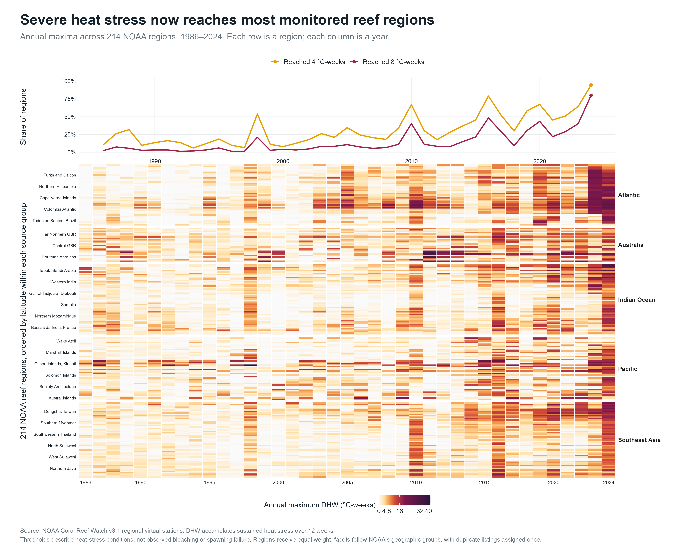
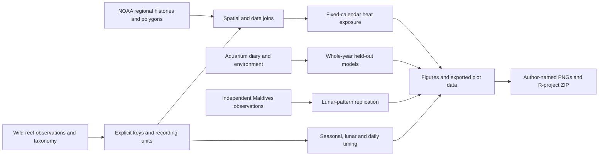

# The Ocean's Clock

Coral reproduction depends on brief windows in the year, the lunar month and the night. Understanding those windows matters for monitoring and restoration: a well-timed spawning event can supply the next generation of a reef. The surrounding ocean, however, is changing.

We connect historical spawning observations with four decades of regional heat-stress records, then ask a separate prediction question using a long aquarium diary: **how much do we learn from the calendar, and does adding environmental information help on a year the model has never seen?**



## What the analysis shows

In 2024, **202 of NOAA's 214 reef regions reached 4 °C-weeks of accumulated heat stress; 171 reached 8 °C-weeks**. These are regional bleaching-stress indicators, not counts of dead reefs or reproductive failures. Region sizes differ, so the percentages describe regions rather than global reef area.

The historical spawning calendars allow a more focused comparison. We hold each calendar fixed and ask how often its months overlap regional heat-stress conditions in different years. For the Gulf of Aqaba, this calendar-weighted exposure index rises from **0% in 1986–1995 to 22.7% in 2015–2024**. Northern Taiwan rises from **1.5% to 26.3%**. Some regions show little or no change in this index. The result identifies changing environmental context around recorded reproductive seasons; it does not show that spawning shifted or reproduction failed.

The aquarium analysis tests a different claim. On **1,007 complete-case dates across 14 years**, a calendar model reduces held-out Brier error from **0.136 to 0.111**. Adding preceding-week temperature and weather produces **0.115**, with no clear improvement in the paired whole-year bootstrap comparison. Environmental cues can matter biologically without necessarily improving this particular daily prediction model.

An independent Maldives study provides another useful check: **70.4% of its 81 recorded spawning atoll-days fall in days 0–7 after full moon**, compared with **69.8% of 400 historical Acropora genus/reef-nights**. The similar concentration is a descriptive replication across different recording designs, not a pooled estimate or a new discovery of lunar control.

Read the [generated findings](outputs/RESULTS.md) for the full interpretation and [aquarium methods](docs/AQUARIUM_METHODS.md) for the validation design.

## Figures

The collection has twelve figures. The climate, calendar-exposure and prediction figures carry the main argument; the geographical, biological and replication figures explain the evidence behind it. Every figure has a high-resolution PNG, a vector SVG and the values used to draw it.

| Figure | What it contributes |
|---|---|
| [01 · Observation atlas](outputs/figures/01_observation_atlas.png) | Projected geography and the uneven historical coverage. |
| [02 · Seasonal calendars](outputs/figures/02_seasonal_calendars.png) | Thirty-four reef-site calendars beside the years that support them. |
| [03 · Lunar timing](outputs/figures/03_lunar_calendars.png) | The full distributions behind a shared post-full-moon concentration. |
| [04 · Time of day](outputs/figures/04_sunset_timing.png) | Individual starting times, sunset alignment and daylight exceptions. |
| [05 · Orpheus Island](outputs/figures/05_one_reef_one_night.png) | Seventeen species on one night, placed in the context of other well-recorded nights. |
| [06 · Regional heat stress](outputs/figures/06_regional_heat_stress.png) | Annual heat-stress histories for all 214 NOAA regions. |
| [07 · Counting choices](outputs/figures/07_weighting_robustness.png) | How the lunar summary changes when repeated nights and subsites receive different weights. |
| [08 · Spawning-season exposure](outputs/figures/08_spawning_season_exposure.png) | Historical biological calendars joined to changing regional conditions. |
| [09 · Seasonal overlap](outputs/figures/09_seasonal_heat_overlap.png) | Which months account for the change at selected regions. |
| [10 · Aquarium diary](outputs/figures/10_aquarium_calendar.png) | Fifteen seasonal diaries containing observed zero as well as positive dates. |
| [11 · Held-out predictions](outputs/figures/11_prediction_validation.png) | Calendar and environmental models tested on excluded years. |
| [12 · Maldives comparison](outputs/figures/12_maldives_replication.png) | An independent Acropora field study, with day and colony weighting kept distinct. |

The [plot-data tables](outputs/tables/) make the graphics inspectable. The [SVG exports](outputs/vector/) allow resizing for a presentation without losing sharpness.

## Data and connections

| Source | Evidence and join |
|---|---|
| [Coral Spawning Database](https://doi.org/10.25405/data.ncl.13082333.v1) | 6,178 source observations. Separate subsite, species and family tables are linked through their published IDs. The natural-reef sample contains 1,026 recorded subsite-dates. |
| [NOAA Coral Reef Watch](https://coralreefwatch.noaa.gov/product/vs/data.php) | More than 3.2 million daily regional records across 214 regions. Published polygons connect 97 of 102 natural-reef subsites to regions; 751 recorded reef-nights also have matching satellite dates. |
| [Okinawa Churaumi Aquarium diary](https://doi.org/10.5281/zenodo.10974150) | 1,350 seasonal diary dates joined by date to 5,479 days of environmental measurements. The prediction sample uses 1,007 dates with complete preceding-week inputs. |
| [Maldives field study](https://doi.org/10.7717/peerj.19447) | An independent 2021–2024 table of 81 spawning atoll-days representing 3,026 colony observations; analysed separately from the historical field and aquarium samples. |
| [US Naval Observatory](https://aa.usno.navy.mil/data/api.html) | A cached independent lunar reference checks seven covered historical reef-nights. It does not validate the full database or the later studies. |

The NOAA source cache contains 3,268,207 station-days through 1 November 2026. The R daily table freezes coverage at 1985–2025, retaining **3,203,007 available records**. Primary heat-stress comparisons use **1986–2024**, the complete common period: the initial 1985 accumulation window and genuinely missing 2025 dates are not silently treated as zero stress.

Regional values are not temperatures measured at each coral. NOAA's virtual stations summarize reef regions using a specified HotSpot statistic. The point-in-polygon join respects those boundaries; unmatched sites remain unmatched. Source definitions, licences and acquisition records are in the [research notes](docs/RESEARCH.md) and the README files under [`data/raw/`](data/raw/).

## The calculations behind the comparisons

For a reef site, the recorded share of spawning nights in each month gives a calendar weight. Sites receive equal weight within their NOAA region so a heavily documented site cannot dominate simply through its record count. The exposure index is

$$
E_{r,y}=\sum_{m=1}^{12}w_{r,m}\left[\frac{1}{|D_{y,m}|}\sum_{d\in D_{y,m}}\mathbf{1}\{\mathrm{DHW}_{r,d}\geq4\}\right].
$$

Here, $w_{r,m}$ is the region's fixed historical spawning-calendar weight for month $m$, and the bracket is the fraction of that month's days at NOAA DHW ≥4 °C-weeks. Eligibility requires at least ten recorded reef-nights across three years at each site; 17 sites contribute calendars to 14 regions. Holding the weights fixed separates a changing heat record from a changing biological calendar. It also means the index cannot measure a shift in spawning itself.

The aquarium model instead predicts whether any tank spawned on an eligible diary date. A whole year is excluded from fitting before predicting it. The Brier score measures the resulting probability errors:

$$
\mathrm{BS}=\frac{1}{n}\sum_{t=1}^{n}(p_t-Y_t)^2.
$$

Lower is better. All three models use the same dates, and uncertainty resamples whole held-out years. Lunar and seasonal sine/cosine terms respect cyclic time; environmental features use only the seven preceding dates. The [method document](docs/AQUARIUM_METHODS.md) explains the response conversion, missingness, retrospective validation and paired bootstrap.

## Reproduce the project

Open `The-Oceans-Clock.Rproj` in RStudio, then run:

```r
source("setup.R")
source("run.R", encoding = "UTF-8")
```

Setup installs missing packages into an ignored project library and needs internet access. The included public data caches then allow the analysis to run without live data services. From a terminal, use `Rscript run.R`. Package versions are recorded in [`outputs/session-info.txt`](outputs/session-info.txt).

The local delivery also provides a genuine `.Rhistory` of the executed entry commands and an optional `.RData` snapshot of selected analytical objects. They are conveniences for inspecting the work in RStudio; the project does not automatically restore them, and the scripts remain the reproducible source of truth. Local session files are excluded from Git and included in the submission bundle.



`R/` contains the numbered analysis and shared design. `data/raw/` preserves downloaded inputs; `data/derived/` contains checked joins and summaries. Figures, vector exports, models and plot tables are under `outputs/`. The [learning guide](docs/LEARNING_GUIDE.md) follows the calculations for someone preparing to explain them.

## Scope and attribution

The field datasets contain recorded occurrences with incomplete survey-effort information. They cannot turn an unrecorded night into an observed absence. The aquarium diary supplies explicit seasonal zero dates, but its models are aquarium-specific and do not become a forecasting service for wild reefs. Likewise, NOAA's bleaching-stress thresholds are environmental context rather than demonstrated reproductive thresholds.

The project contributes its own source integration, fixed-calendar comparison and held-out daily model evaluation. Prior research already establishes environmental and astronomical associations with coral reproduction; we do not present those associations as newly discovered. Relevant literature and the precise limits of our comparisons are collected in [RESEARCH.md](docs/RESEARCH.md).

Biological sources are credited to Baird et al. (2021), Sakai, Yamamoto and Maruyama (2024), and Sheridan et al. (2025). Heat-stress data are provided by NOAA Coral Reef Watch. Independent lunar reference: USNO. Source datasets retain their original terms and each figure names its sources.

Mihael and Pirasanna are the project team. [`authors.csv`](authors.csv) records the provisional main-author distribution for export; actual contributions and understanding must be reviewed by the students. Run `source("export_submission.R")` to create named PNGs and the complete project ZIP. The [course notes](docs/COURSE_REQUIREMENTS.md) retain the remaining administrative questions: permission for a two-person group and Prezi, any later rubric/report instructions, attendance, presentation and Moodle submission.
