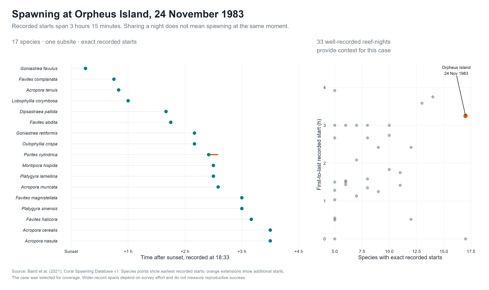
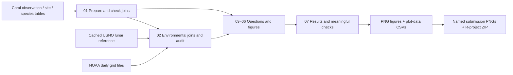

# The Ocean's Clock

**What tells a reef that tonight is the night?**

Corals are animals. Many release eggs and sperm into the water during shared spawning events. This project explores their recorded schedules across seasons, lunar cycles and hours of the day, then connects selected events to ocean temperature.

An applied data-science project in **R**, built around readable **tidyverse** transformations and **ggplot2** figures. No website, dashboard or presentation software is needed to reproduce it.



On one documented Orpheus Island night, 17 species had exact recorded starts spanning more than three hours. A shared spawning night does not mean an identical appointment. This is an illustrative case selected for its coverage, not a universal species timetable.

## Explore the work

| Figure | Question | Export |
|---|---|---|
| Observation atlas | Where do we actually have evidence? | [01 · Geographic coverage](outputs/figures/01_observation_atlas.png) |
| Seasonal calendars | Do recorded seasons differ among reefs? | [02 · Monthly calendars](outputs/figures/02_seasonal_calendars.png) |
| Lunar calendars | Do coral genera share the same lunar window? | [03 · Genus heatmap](outputs/figures/03_lunar_calendars.png) |
| Sunset timing | Is sunset a common reference for every group? | [04 · Exact start times](outputs/figures/04_sunset_timing.png) |
| A single night | How closely do different species synchronize locally? | [05 · Species appointments](outputs/figures/05_one_reef_one_night.png) |
| Thermal seasons | What ocean conditions accompany selected events? | [06 · 2016 temperature context](outputs/figures/06_thermal_seasons.png) |
| A fairer count | Does the lunar pattern survive different weighting? | [07 · Sensitivity analysis](outputs/figures/07_weighting_robustness.png) |
| Combined clock | How do season, Moon and temperature meet in one view? | [08 · Integrated calendar](outputs/figures/08_integrated_clock.png) |

All figures are high-resolution PNGs. Their plotted values are exported to [`outputs/tables/`](outputs/tables/). Read the generated [findings and limitations](outputs/RESULTS.md) alongside the graphics.

## Reproduce in RStudio

1. Open `The-Oceans-Clock.Rproj` with R 4.2 or newer.
2. Run `source("setup.R")` once to install missing packages in an ignored project library. An internet connection is needed for installation.
3. Run `source("run.R", encoding = "UTF-8")` from the project root. Included data caches make the completed analysis reproducible without live data-service access.

From a terminal: `Rscript run.R`. `outputs/session-info.txt` records the versions used for the delivered build. Opening an RStudio project does not restore an old workspace, and closing it does not save `.RData`. Scripts explicitly load their inputs. `.Rhistory`, `.RData` and `.Rproj.user` are local session state, not project inputs.

## Small, explicit structure



```text
R/                 numbered analysis scripts and one shared plot style
data/raw/          original public source files and API responses
data/derived/      joined, checked analytical tables
outputs/figures/   eight final graphics
outputs/tables/    the values behind those graphics
docs/              sources, course scope, decisions and learning guide
run.R              rebuild the analysis in visible order
setup.R            install missing R packages once
authors.csv        main-author export assignments
export_submission.R  create named PNGs and the project ZIP
```

## Connections with a purpose

| Source | Role | Connection |
|---|---|---|
| [Baird et al., Coral Spawning Database v1](https://doi.org/10.25405/data.ncl.13082333.v1) | Biological occurrences, taxa, geography and supplied lunar/solar fields | Observation → subsite via `Subsite_ID`; species via `Coral_ID`; family via `Systematics_ID`. |
| [US Naval Observatory API](https://aa.usno.navy.mil/data/api.html) | Independent full-moon reference | UTC event time → source local UTC offset → calendar-day difference. Coverage is limited to the successful cached response and reported in the audit. |
| [NOAA OISST v2.1](https://www.ncei.noaa.gov/products/optimum-interpolation-sst) | Additional ocean-surface temperature context | Subsite coordinates → nearest valid grid cell; actual returned UTC date → recorded local date, with the daily-date approximation stated. |

The NOAA subset services were unavailable during the build. The final environmental case study uses original NCEI daily NetCDF grids for a bounded 2016 selection: first-of-month reference dates and exact recorded spawning dates. It does not imply a full historical climate analysis. Files, checksums and request details are retained for reproducibility. See [data provenance](data/raw/README.md) and the enrichment script.

The independent lunar API check validates a small covered sample; it does **not** independently validate the full database. Main lunar graphics retain the supplied lunar offsets. The astronomy is not presented as a newly invented biological predictor.

## The extra work is in the reasoning

- Reconstruct separate relational tables and reject row multiplication or unmatched keys.
- Distinguish field observations from ex-situ records and exact times from approximate times.
- Count observation rows, reef-nights and genus-nights separately. Multiple species rows are not independent nights.
- Compare the lunar result under three defensible weighting schemes.
- Preserve genuine dawn spawning and flag an ambiguous midnight event.
- Inspect original temperature grid units, dates, coordinates and missing values before joining.
- Export plot data, document limitations, run from a clean session and inspect the actual PNGs.

These are **occurrence records**. Unknown survey effort means the graphics cannot establish the probability of spawning on an arbitrary night, a causal environmental trigger or a reliable future forecast. The project is an original combination and analysis of public sources; it does not claim that the underlying scientific subject has never been studied.

## Course and authorship

Mihael and Pirasanna are the project team. [`authors.csv`](authors.csv) records an agreed provisional main-author distribution for exports; it is not evidence of work already performed. Record actual contributions and learn the transformations in the [learning guide](docs/LEARNING_GUIDE.md).

The [course checklist](docs/COURSE_REQUIREMENTS.md) retains the published requirements: attendance, individual contribution, presentation, named PNGs, complete R-project ZIP and Moodle upload. **The published brief specifies 3–5 people and a PowerPoint presentation; the team must confirm permission for two people and Prezi.** The later jury rubric and any separate-report requirement still need confirmation. No slides are generated here.

After agreeing on ownership, run `source("export_submission.R")`. The ignored `submission/` directory receives named PNGs and the project ZIP. Final upload, attendance and oral presentation remain student responsibilities.

## Attribution

Biological data: Baird et al. (2021), *An Indo-Pacific coral spawning database*, Scientific Data, [paper](https://www.nature.com/articles/s41597-020-00793-8), [data DOI](https://doi.org/10.25405/data.ncl.13082333.v1). The source catalogue declares CC0 for this dataset version. Astronomy: US Naval Observatory Astronomical Applications. Temperature: NOAA National Centers for Environmental Information, OISST v2.1. Basemap: `maps` package `world2`. Each figure identifies its relevant sources; source datasets retain their original terms.
